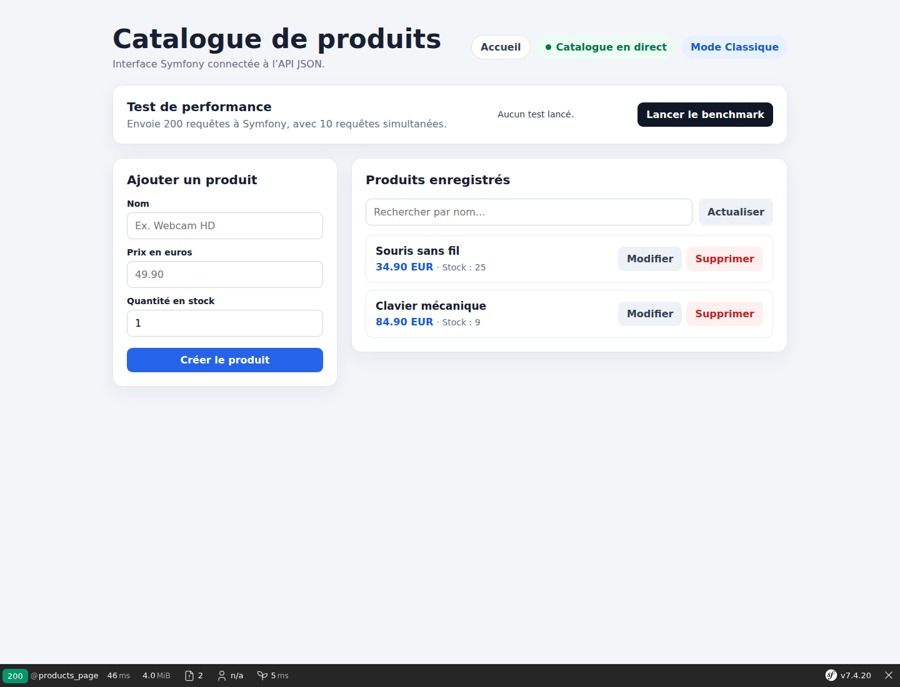

# Symfony et Mercure : synchroniser un catalogue de produits en temps réel

Dans notre première découverte de Mercure, nous avons envoyé un message simple depuis Symfony vers plusieurs onglets. Cette expérience permettait de comprendre le Hub, les topics, `EventSource` et les Server-Sent Events.

Passons maintenant à un cas plus proche d’une véritable application : synchroniser un catalogue de produits après une écriture en base de données.

Le code complet est disponible sur GitHub :

<https://github.com/amine-betari/frankenphp-formation>

## Le problème à résoudre

Notre catalogue Symfony possède déjà une API REST, une base SQLite et une interface Twig. Avant Mercure, la modification d’un stock suivait ce parcours :

```text
Onglet A → PATCH /api/products/42 → Symfony → Doctrine → SQLite
Onglet A ← réponse JSON
```

L’onglet qui effectuait la modification rechargeait ensuite sa liste. Mais un deuxième onglet déjà ouvert continuait d’afficher l’ancien stock.

```text
Onglet A : stock actualisé
Onglet B : ancien stock
```

L’objectif est que toutes les pages ouvertes se mettent à jour automatiquement après une création, une modification ou une suppression.



## La base de données reste la source de vérité

Mercure ne remplace pas SQLite et ne modifie aucun produit. La responsabilité reste clairement séparée :

```text
API + Doctrine : enregistrer le nouvel état
Mercure        : annoncer que cet état a changé
```

L’ordre des opérations est essentiel :

```php
$product->setStock($newStock);
$entityManager->flush();
$publisher->publish('product.updated', $product);
```

Nous publions **après** `flush()`. Si l’écriture en base échoue, aucun événement ne doit annoncer une modification qui n’existe pas.

## Un topic pour le catalogue

Toutes les pages du catalogue écoutent le même topic :

```text
https://frankenphp.local/products
```

Ce topic est l’identifiant du canal. Ce n’est pas une page web à ouvrir. Symfony publie dessus et les navigateurs s’y abonnent.

Pour ce premier cas métier, un topic général simplifie la synchronisation de la liste. Une application plus avancée pourrait aussi employer un topic par produit, par exemple `https://example.com/products/42`.

## Isoler la publication dans un service

Au lieu de construire les événements dans chaque action du contrôleur, nous créons `ProductUpdatePublisher` :

```php
final class ProductUpdatePublisher
{
    public const TOPIC = 'https://frankenphp.local/products';

    public function __construct(private readonly HubInterface $hub)
    {
    }

    public function publish(string $type, Product $product, ?int $productId = null): void
    {
        $this->hub->publish(new Update(
            self::TOPIC,
            json_encode([
                'type' => $type,
                'product' => [
                    'id' => $productId ?? $product->getId(),
                    'name' => $product->getName(),
                    'price' => number_format(
                        $product->getPriceCents() / 100,
                        2,
                        '.',
                        ''
                    ).' EUR',
                    'stock' => $product->getStock(),
                ],
            ], JSON_THROW_ON_ERROR | JSON_UNESCAPED_UNICODE),
        ));
    }
}
```

Le message contient deux informations importantes :

- `type` indique ce qui vient de se produire ;
- `product` contient l’état utile à l’interface.

Exemple reçu après une modification :

```json
{
  "type": "product.updated",
  "product": {
    "id": 1,
    "name": "Clavier mécanique",
    "price": "84.90 EUR",
    "stock": 10
  }
}
```

## Publier après chaque opération REST

### Création

```php
$entityManager->persist($product);
$entityManager->flush();
$publisher->publish('product.created', $product);
```

### Modification

```php
$product->setStock((int) $data['stock']);
$entityManager->flush();
$publisher->publish('product.updated', $product);
```

### Suppression

La suppression possède un détail important. Après `remove()` et `flush()`, Doctrine peut remettre l’identifiant de l’entité à `null`. Nous le mémorisons donc avant la suppression :

```php
$productId = $product->getId();
$entityManager->remove($product);
$entityManager->flush();
$publisher->publish('product.deleted', $product, $productId);
```

L’événement est toujours publié après le `flush()`, mais il conserve le bon identifiant afin que le navigateur sache quelle carte retirer.

## Donner le topic à Twig

Le contrôleur de la page transmet la constante du service :

```php
return $this->render('product/index.html.twig', [
    'execution_mode' => getenv('DEMO_MODE') ?: 'inconnu',
    'mercure_topic' => ProductUpdatePublisher::TOPIC,
]);
```

Twig utilise ensuite la fonction `mercure()` pour générer l’URL complète du Hub avec le bon matcher :

```javascript
const mercureUrl = {{ mercure(mercure_topic)|json_encode|raw }};
const eventSource = new EventSource(mercureUrl);
```

Le navigateur ouvre directement une connexion SSE vers le Hub. Symfony n’a pas besoin de garder la requête de la page ouverte.

## Afficher l’état de la connexion

Les callbacks d’`EventSource` permettent d’informer l’utilisateur :

```javascript
eventSource.onopen = () => {
    status.textContent = 'Catalogue en direct';
};

eventSource.onerror = () => {
    status.textContent = 'Reconnexion Mercure…';
};
```

`EventSource` tente automatiquement de se reconnecter après une interruption.

## Mettre à jour uniquement le produit concerné

À la réception, le JavaScript lit le type de l’événement :

```javascript
eventSource.onmessage = event => {
    const update = JSON.parse(event.data);
    const product = update.product;

    if (update.type === 'product.deleted') {
        document
            .querySelector(`[data-product-id="${product.id}"]`)
            ?.remove();
    } else {
        upsertProduct(product);
    }
};
```

`upsertProduct()` remplace la carte si elle existe et l’ajoute sinon. Nous ne rechargeons donc ni la page ni toute la liste.

Chaque carte possède l’identifiant du produit :

```html
<article class="product" data-product-id="42">
    <!-- nom, prix, stock et actions -->
</article>
```

Une courte animation verte permet de voir quelle carte vient d’être actualisée par Mercure.

## Tester avec deux onglets

Démarrez le laboratoire :

```bash
docker compose up -d
```

Ouvrez deux fois :

<http://localhost:8384/products>

Attendez que les deux pages affichent **Catalogue en direct**, puis essayez :

1. créer un produit dans l’onglet A ;
2. observer son apparition dans l’onglet B ;
3. modifier son stock dans l’onglet B ;
4. observer la nouvelle valeur dans l’onglet A ;
5. supprimer le produit et vérifier sa disparition dans les deux onglets.

Le test automatisé du laboratoire a reçu successivement :

```text
product.created
product.updated
product.deleted
```

## Ce que cet exemple apporte de plus

Le premier exemple démontrait le transport d’un message. Celui-ci relie Mercure au cycle métier réel :

```text
Utilisateur
    ↓
API REST Symfony
    ↓
Doctrine + SQLite
    ↓ après flush réussi
ProductUpdatePublisher
    ↓
Hub Mercure
    ↓
Tous les catalogues ouverts
```

## Limite à connaître en production

Dans cette démonstration, l’écriture en base et la publication Mercure sont deux opérations successives. Si la base est enregistrée mais que le Hub devient indisponible juste après, les données restent correctes mais l’événement peut ne pas être envoyé.

Pour un système critique, on peut utiliser un modèle **transactional outbox** : l’événement est d’abord enregistré dans la même transaction que la donnée, puis publié de manière asynchrone. Ce mécanisme dépasse le cadre de ce laboratoire, mais il est important de connaître cette limite.

## À retenir

- la base de données reste la source de vérité ;
- l’événement Mercure est publié après le `flush()` ;
- le type décrit l’action métier ;
- le payload contient les données nécessaires à l’interface ;
- tous les onglets abonnés au topic reçoivent la même modification ;
- le navigateur peut mettre à jour une seule carte sans recharger la page ;
- l’identifiant doit être mémorisé avant une suppression Doctrine.

Retrouvez également le premier article : [Mercure avec Symfony : comprendre et créer une première route temps réel](https://www.abetari.com/mercure-symfony-premiere-route-temps-reel/).
