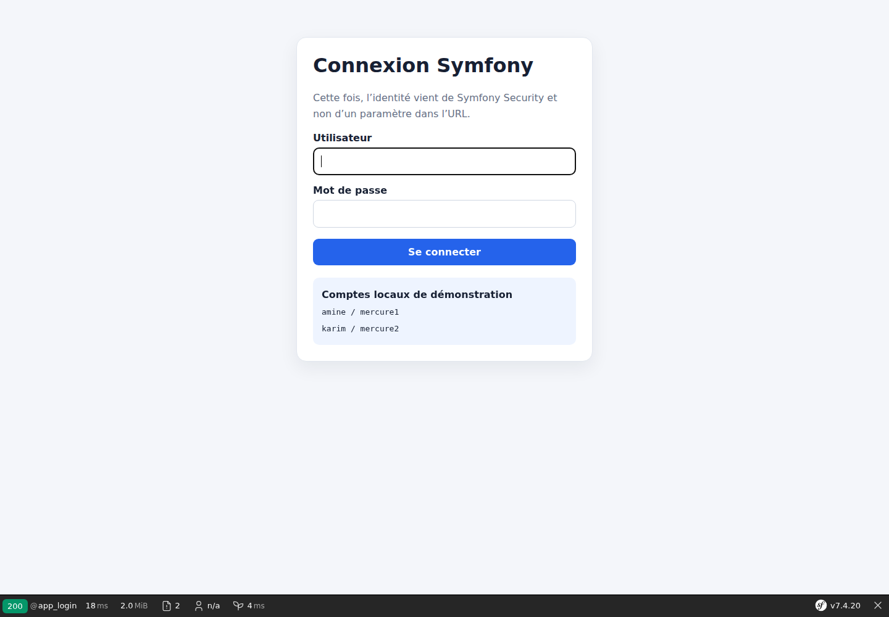

# Symfony et Mercure : sécuriser des notifications privées avec JWT

Après avoir découvert Mercure avec une première route puis synchronisé un catalogue, passons à une question indispensable : comment envoyer une notification à un utilisateur sans que les autres puissent la recevoir ?

Le code complet de ce laboratoire est disponible sur GitHub :

<https://github.com/amine-betari/frankenphp-formation>

## Le besoin fonctionnel

Notre exemple contient deux comptes locaux, `amine` et `karim`. Chaque utilisateur possède son propre canal de notifications.

```text
Notification destinée à Amine
→ visible immédiatement chez Amine
→ invisible chez Karim
```

Recevoir les messages en temps réel ne suffit donc pas. Le Hub doit aussi vérifier que la personne connectée a le droit d'écouter le topic demandé.

## Les quatre notions à distinguer

```text
Symfony Security → détermine qui est connecté
Topic            → nomme le canal de notifications
JWT              → décrit les topics autorisés
Mercure          → vérifie le JWT et distribue le message
```

Pour Amine, le topic est :

```text
https://frankenphp.local/users/amine/notifications
```

Pour Karim :

```text
https://frankenphp.local/users/karim/notifications
```

Un topic sépare les flux, mais cette séparation ne constitue pas encore une protection. La protection vient du JWT et du caractère privé de l'événement.

## Configurer deux comptes de démonstration

Pour rester concentré sur Mercure, le laboratoire utilise le provider en mémoire de Symfony. Les mots de passe sont hachés dans `security.yaml`.

```yaml
security:
    password_hashers:
        Symfony\Component\Security\Core\User\PasswordAuthenticatedUserInterface: 'auto'

    providers:
        users_in_memory:
            memory:
                users:
                    amine:
                        password: '<mot-de-passe-haché>'
                        roles: ['ROLE_USER']
                    karim:
                        password: '<mot-de-passe-haché>'
                        roles: ['ROLE_USER']
```

Dans une véritable application, ces utilisateurs seraient généralement chargés depuis une base de données. Le provider en mémoire est ici un outil pédagogique.

## Activer la connexion Symfony

Le firewall utilise `form_login` et protège les routes de la démonstration :

```yaml
firewalls:
    main:
        lazy: true
        provider: users_in_memory
        form_login:
            login_path: app_login
            check_path: app_login
            enable_csrf: true
            default_target_path: app_mercure_topics
        logout:
            path: app_logout
            target: app_login

access_control:
    - { path: ^/mercure-private, roles: ROLE_USER }
    - { path: ^/api/mercure/private, roles: ROLE_USER }
```

Une personne non connectée qui visite `/mercure-private` est automatiquement redirigée vers `/mercure-login`.



## Utiliser l'identité réelle dans le contrôleur

La première version pédagogique choisissait artificiellement l'utilisateur avec `?user=1`. Cette version utilise l'identité conservée dans la session Symfony :

```php
$username = $this->getUser()?->getUserIdentifier();

if (null === $username) {
    throw $this->createAccessDeniedException();
}

$topic = 'https://frankenphp.local/users/'.$username.'/notifications';
```

Modifier l'URL ne permet donc plus de changer d'identité. Symfony décide qui est connecté avant de calculer le topic.

## Générer un JWT d'abonnement

Dans Twig, la fonction `mercure()` peut demander à Symfony de créer une autorisation d'abonnement limitée au topic courant :

```twig
{{ mercure(topic, {subscribe: topic}) }}
```

Symfony signe alors un JWT qui signifie, de manière simplifiée :

```text
Ce client peut s'abonner uniquement au topic d'Amine.
```

Le token est placé dans un cookie `HttpOnly`. Le JavaScript ne peut pas le lire, ce qui limite son exposition, mais le navigateur peut le transmettre au Hub.

## Envoyer le cookie avec EventSource

Le navigateur ouvre la connexion SSE avec `withCredentials: true` :

```javascript
const eventSource = new EventSource(
    mercureUrl,
    {withCredentials: true},
);
```

Le parcours est maintenant :

```text
Navigateur → demande le topic d'Amine
Navigateur → transmet le cookie JWT
Mercure    → vérifie la signature et les autorisations
Mercure    → accepte ou filtre les événements
```

Sans `withCredentials`, le cookie ne serait pas transmis lors de cette connexion entre les ports `8384` et `3001`.

## Rendre l'événement privé

Le JWT seul ne rend pas automatiquement un message privé. Il faut marquer l'update comme privée avec le troisième argument de `Update` :

```php
$hub->publish(new Update(
    $topic,
    json_encode($event, JSON_THROW_ON_ERROR),
    true,
));
```

Le `true` demande à Mercure de vérifier les autorisations des abonnés avant de leur transmettre cet événement.

Sans ce troisième argument, l'update resterait publique et un abonnement anonyme correspondant pourrait la recevoir.

## Adapter le cookie au HTTP local

Mercure 1 utilise normalement un cookie sécurisé préfixé par `__Secure-`, adapté à HTTPS. Notre laboratoire fonctionne volontairement sur `http://localhost`. Nous configurons donc un nom sans préfixe pour le développement :

```yaml
MERCURE_EXTRA_DIRECTIVES: |
    anonymous
    cors_origins http://localhost:8384 http://localhost:8385
    cookie_name mercure_access_token
    resource_identifier http://localhost:3001/.well-known/mercure
```

En production HTTPS, il faut utiliser le cookie sécurisé proposé par défaut et ne pas reprendre aveuglément ce réglage local.

## Tester depuis l'interface

Démarrez les services :

```bash
docker compose up -d
```

Ouvrez :

<http://localhost:8384/mercure-private>

La page redirige vers le formulaire de connexion. Après authentification avec le compte de démonstration `amine`, deux scénarios sont disponibles.

### Test autorisé

```text
JWT d'Amine + topic d'Amine
→ événement privé reçu
```

### Test interdit

```text
JWT d'Amine + topic de Karim
→ événement publié par le laboratoire
→ événement non transmis à Amine
```

Le Hub peut accepter la connexion SSE tout en filtrant les événements privés non autorisés. Le test important n'est donc pas seulement le statut HTTP : il faut vérifier que le message privé interdit n'arrive jamais dans le flux.

## Pourquoi conserver deux protections

Symfony et Mercure ne protègent pas exactement la même chose :

```text
Symfony Security
→ protège la page et les routes HTTP

JWT Mercure
→ protège la réception des événements SSE privés
```

Protéger uniquement la page ne suffit pas : un client pourrait essayer de contacter directement le Hub. Protéger uniquement Mercure ne remplace pas non plus les contrôles d'accès métier de l'application.

## Limites volontaires du laboratoire

Le bouton qui publie un message destiné à Karim existe uniquement pour rendre le refus visible. Dans une vraie application, un utilisateur ne devrait pas pouvoir choisir librement le destinataire d'un événement sensible.

La publication proviendrait plutôt d'une action métier autorisée :

```text
Paiement accepté
→ Symfony enregistre la commande
→ Symfony publie une notification privée au propriétaire
→ Mercure la transmet uniquement à ce propriétaire
```

Il faudrait également remplacer les comptes en mémoire par des utilisateurs persistés en base, ajouter les règles métier avec les voters Symfony et conserver les secrets JWT hors du dépôt.

## Le circuit complet

```text
1. Amine se connecte avec Symfony Security
2. Symfony récupère son identifiant depuis la session
3. Symfony calcule le topic personnel d'Amine
4. Symfony génère un JWT limité à ce topic
5. Le navigateur transmet le JWT au Hub dans un cookie HttpOnly
6. Symfony publie une Update privée
7. Mercure compare le topic avec les droits du JWT
8. Le message est transmis à Amine et filtré pour les autres
```

## À retenir

- le topic identifie un flux mais ne suffit pas à le sécuriser ;
- Symfony Security fournit l'identité connectée ;
- le JWT décrit les topics que cette identité peut écouter ;
- le cookie `HttpOnly` transporte le JWT jusqu'au Hub ;
- `withCredentials: true` permet à `EventSource` d'envoyer ce cookie ;
- une `Update` doit être explicitement marquée privée ;
- Mercure distribue l'événement uniquement si le JWT couvre son topic ;
- les comptes en mémoire et la publication vers un autre utilisateur restent des outils de démonstration.

Pour reprendre depuis le début, consultez également :

- [Mercure avec Symfony : comprendre et créer une première route temps réel](https://www.abetari.com/mercure-symfony-premiere-route-temps-reel/)
- [Symfony et Mercure : synchroniser un catalogue de produits en temps réel](https://www.abetari.com/symfony-mercure-catalogue-produits-temps-reel/)
