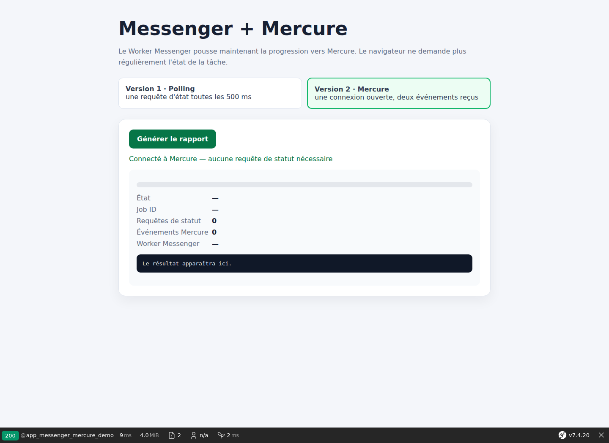

# Symfony Messenger et Mercure : suivre un traitement en arrière-plan sans polling

Un traitement long ne devrait pas bloquer une requête HTTP pendant plusieurs secondes ou plusieurs minutes. Symfony Messenger permet de confier ce travail à un processus séparé. Mercure peut ensuite informer le navigateur lorsque l'état du traitement change.

Dans ce laboratoire, nous construisons d'abord une version avec polling, puis nous remplaçons les demandes répétées du navigateur par deux événements Mercure.

Le code complet est disponible sur GitHub :

<https://github.com/amine-betari/frankenphp-formation>

## Le cas pratique

L'utilisateur demande la génération d'un rapport. Le traitement dure volontairement trois secondes.

Sans traitement asynchrone :

```text
Navigateur → requête HTTP → traitement de 3 secondes → réponse
```

Avec Messenger :

```text
Navigateur → requête HTTP → message placé dans la file → réponse HTTP 202
                                      ↓
                              Worker Messenger
                                      ↓
                             traitement de 3 secondes
```

Lors de nos mesures, l'API a répondu en environ `0,02 s`, tandis que le rapport continuait à être généré dans un autre conteneur.

## Un Worker Messenger séparé

Le fichier `compose.yaml` contient un service consacré aux tâches asynchrones :

```yaml
messenger-worker:
    image: dunglas/frankenphp:1-php8.5-bookworm
    working_dir: /app
    environment:
        APP_ENV: dev
        MESSENGER_TRANSPORT_DSN: doctrine://default?auto_setup=0
        MERCURE_URL: http://host.docker.internal:3001/.well-known/mercure
        MERCURE_PUBLIC_URL: http://localhost:3001/.well-known/mercure
        MERCURE_JWT_SECRET: mercure-local-development-secret
    command: php bin/console messenger:consume async --time-limit=3600 --memory-limit=128M -vv
    volumes:
        - ./franken-symfony:/app
    restart: unless-stopped
```

Ce conteneur n'expose aucun port web. Il attend les messages de la file `async`, les traite, puis attend les suivants.

Il ne faut pas le confondre avec le Worker FrankenPHP :

```text
Worker FrankenPHP  → traite les requêtes HTTP
Worker Messenger   → traite les tâches en arrière-plan
```

Les applications des ports `8384` et `8385` peuvent toutes les deux produire des messages. Le même Worker Messenger les consomme ensuite.

## Décrire le travail avec un message

Le message transporte uniquement les informations nécessaires au traitement :

```php
final readonly class GenerateDemoReport
{
    public function __construct(
        public string $jobId,
        public string $httpInstance,
        public int $httpPid,
    ) {
    }
}
```

Il ne contient pas la logique du rapport. Il représente une demande de travail.

Le routage indique à Messenger que ce message doit passer par la file `async` :

```yaml
framework:
    messenger:
        routing:
            App\Message\GenerateDemoReport: async
```

Sans ce routage, le Handler pourrait être exécuté immédiatement dans la requête HTTP, ce qui supprimerait le bénéfice de l'asynchronisme.

## Produire la tâche depuis le contrôleur

Le contrôleur crée un identifiant, mémorise l'état initial puis envoie le message :

```php
$jobId = bin2hex(random_bytes(8));

$jobStore->write($jobId, [
    'id' => $jobId,
    'status' => 'queued',
    'progress' => 0,
    'message' => 'Tâche placée dans la file Messenger.',
]);

$bus->dispatch(new GenerateDemoReport(
    $jobId,
    gethostname(),
    getmypid(),
));

return $this->json([
    'accepted' => true,
    'job_id' => $jobId,
], 202);
```

Le statut HTTP `202 Accepted` signifie que la demande a été acceptée, mais que le traitement n'est pas encore terminé.

## Exécuter la tâche dans le Handler

Le Worker Messenger récupère le message et appelle automatiquement le Handler :

```php
#[AsMessageHandler]
final readonly class GenerateDemoReportHandler
{
    public function __invoke(GenerateDemoReport $message): void
    {
        // début du traitement
        sleep(3);
        // fin du traitement
    }
}
```

Le Worker ne connaît pas notre métier. Il sait seulement recevoir un message et appeler le Handler correspondant. C'est notre code PHP qui décide quoi exécuter.

## Première version : suivre l'état avec du polling

La première interface est disponible ici :

<http://localhost:8384/messenger-demo>

Elle appelle l'API de statut toutes les 500 millisecondes :

```javascript
async function refresh(statusUrl) {
    const response = await fetch(statusUrl);
    const job = await response.json();

    if (job.status !== 'completed') {
        setTimeout(() => refresh(statusUrl), 500);
    }
}
```

Le dialogue ressemble à ceci :

```text
Navigateur : le rapport est-il terminé ?
Symfony    : non, running.
Navigateur : et maintenant ?
Symfony    : non.
Navigateur : et maintenant ?
Symfony    : oui, completed.
```

Cette solution est simple et parfaitement utilisable pour certains besoins. Sa limite est qu'elle génère plusieurs requêtes, même lorsqu'aucun état n'a changé.

## Deuxième version : le Handler publie vers Mercure

La seconde interface est disponible ici :

<http://localhost:8384/messenger-mercure-demo>

Nous isolons la publication dans `MessengerProgressPublisher` :

```php
final readonly class MessengerProgressPublisher
{
    public const TOPIC = 'https://frankenphp.local/messenger/jobs';

    public function __construct(private HubInterface $hub)
    {
    }

    public function publish(array $job): void
    {
        $this->hub->publish(new Update(
            self::TOPIC,
            json_encode($job, JSON_THROW_ON_ERROR),
        ));
    }
}
```

Le Handler l'appelle aux moments choisis par notre code.

### Événement 1 : début

```php
$runningJob = [
    'id' => $message->jobId,
    'status' => 'running',
    'progress' => 25,
];

$jobStore->write($message->jobId, $runningJob);
$this->progressPublisher->publish($runningJob);
```

### Événement 2 : fin

```php
$completedJob = [
    'id' => $message->jobId,
    'status' => 'completed',
    'progress' => 100,
    'result' => $result,
];

$jobStore->write($message->jobId, $completedJob);
$this->progressPublisher->publish($completedJob);
```

Mercure reçoit donc exactement deux événements dans cette démonstration :

```text
running   → 25 %
completed → 100 %
```

Mercure ne crée pas ces états et le Worker ne les devine pas. Notre Handler décide quand appeler `publish()`. Le Worker exécute ce code, puis Mercure transporte les données.

## Le navigateur écoute au lieu de demander

La seconde page ouvre une connexion SSE :

```javascript
const eventSource = new EventSource(mercureUrl);

eventSource.onmessage = event => {
    const job = JSON.parse(event.data);

    if (job.id === currentJobId) {
        displayJob(job);
    }
};
```

Le navigateur ne lance plus de requête vers l'API de statut. Il attend les annonces du Hub.



## Comparaison directe

| Version | Requêtes de statut | Informations reçues |
|---|---:|---:|
| Messenger + polling | environ 7 à 8 | états JSON demandés toutes les 500 ms |
| Messenger + Mercure | 0 | 2 événements poussés par le Hub |

Le traitement de fond est identique dans les deux cas. Seule la communication avec le navigateur change.

```text
POLLING
Navigateur → API → Navigateur → API → Navigateur → API

MERCURE
Handler → Mercure → Navigateur
Handler → Mercure → Navigateur
```

## Pourquoi conserver l'état en plus des événements ?

Notre exemple écrit également l'état dans `DemoJobStore`. Mercure transporte une information à un instant donné, mais il ne remplace pas forcément le stockage durable de l'état métier.

Si le navigateur est fermé au moment de l'événement, l'application doit encore pouvoir retrouver le résultat du rapport. Dans une application réelle, cet état serait généralement enregistré en base de données ou dans un stockage adapté plutôt que dans les fichiers temporaires utilisés par ce laboratoire.

## Limites et améliorations pour la production

Cette démonstration privilégie la compréhension. Une version de production devrait notamment :

- utiliser une entité persistée pour suivre les tâches ;
- sécuriser le topic par utilisateur avec un JWT Mercure ;
- publier de vrais jalons métier plutôt que des pourcentages artificiels ;
- gérer les échecs et le transport `failed` de Messenger ;
- définir une stratégie de retry adaptée ;
- éviter de rejouer un traitement non idempotent après une erreur ;
- superviser le Worker Messenger ;
- découpler éventuellement la publication Mercure du traitement principal.

Un point mérite une attention particulière : dans notre Handler, une panne de Mercure peut faire échouer le message Messenger et provoquer une nouvelle tentative. Un traitement métier rejouable doit donc être idempotent, ou la publication doit être découplée avec une stratégie comme l'outbox.

## Le circuit complet

```text
1. Le navigateur demande un rapport
2. Symfony place GenerateDemoReport dans la file async
3. Symfony répond immédiatement avec HTTP 202
4. Le Worker Messenger récupère le message
5. Le Handler publie running vers Mercure
6. Le navigateur affiche 25 %
7. Le Handler effectue le traitement
8. Le Handler publie completed vers Mercure
9. Le navigateur affiche le résultat
```

## À retenir

- Messenger déplace un traitement hors de la requête HTTP ;
- le Worker Messenger consomme la file et exécute le Handler ;
- le Handler contient notre logique métier ;
- notre code décide quand publier les changements d'état ;
- le polling demande régulièrement l'état à Symfony ;
- Mercure pousse uniquement les changements au navigateur ;
- dans notre exemple, Mercure reçoit deux événements : début et fin ;
- le Worker FrankenPHP et le Worker Messenger ont des responsabilités différentes ;
- Mercure transporte les événements, mais ne remplace pas le stockage de l'état.

Articles précédents :

- [Mercure avec Symfony : comprendre et créer une première route temps réel](https://www.abetari.com/mercure-symfony-premiere-route-temps-reel/)
- [Symfony et Mercure : sécuriser des notifications privées avec JWT](https://www.abetari.com/symfony-mercure-notifications-privees-jwt/)
