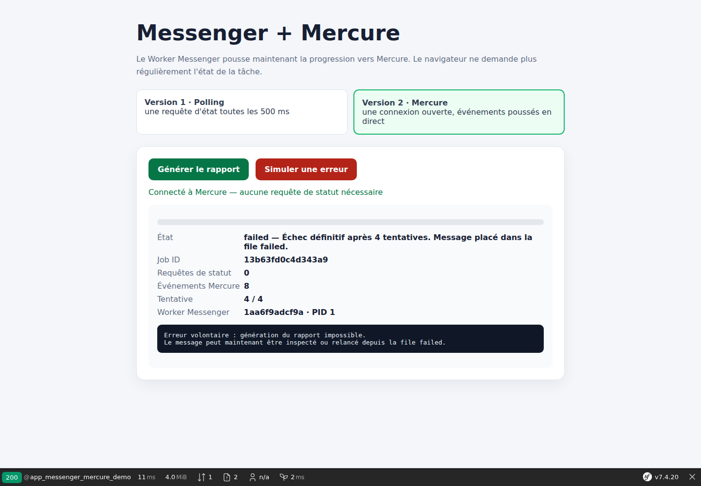

# Symfony Messenger : retries, file failed et suivi en temps réel avec Mercure

Une tâche asynchrone peut échouer : API distante indisponible, fichier illisible, base de données momentanément inaccessible ou erreur métier. Symfony Messenger peut alors retenter automatiquement le traitement, puis isoler le message si toutes les tentatives échouent.

Dans ce laboratoire, nous provoquons volontairement une erreur et nous affichons son cycle de vie dans le navigateur avec Mercure :

```text
running → retrying → running → retrying → running → retrying → running → failed
```

Le code complet est disponible sur GitHub :

<https://github.com/amine-betari/frankenphp-formation>

## Tester le scénario

Démarrer les conteneurs :

```bash
docker compose up -d
```

Ouvrir ensuite :

<http://localhost:8384/messenger-mercure-demo>

Le bouton **Générer le rapport** conserve le scénario normal. Le bouton **Simuler une erreur** lance le nouveau scénario.

L'interface affiche la tentative courante, l'état du message et le processus Worker Messenger qui exécute le traitement. Le navigateur ne fait aucun polling : les changements sont poussés par Mercure.



## Première idée importante : qui fait quoi ?

Trois composants collaborent, mais leurs rôles sont différents :

```text
Notre Handler     → exécute le travail et déclenche l'erreur
Symfony Messenger → programme les nouvelles tentatives
Mercure           → transporte chaque nouvel état vers le navigateur
```

Mercure ne relance pas le traitement. Le Worker Messenger ne crée pas non plus les événements visuels tout seul. Notre application observe le cycle Messenger et publie les états utiles.

## Déclencher une erreur contrôlée

Le message contient un booléen réservé à la démonstration :

```php
final readonly class GenerateDemoReport
{
    public function __construct(
        public string $jobId,
        public string $httpInstance,
        public int $httpPid,
        public bool $shouldFail = false,
    ) {
    }
}
```

Le contrôleur lit la valeur envoyée par le second bouton puis place le message dans la file `async` :

```php
$payload = json_decode($request->getContent(), true);
$shouldFail = is_array($payload) && true === ($payload['fail'] ?? false);

$bus->dispatch(new GenerateDemoReport(
    $jobId,
    $httpInstance,
    $httpPid,
    $shouldFail,
));
```

Dans le Handler, le scénario normal continue jusqu'au statut `completed`. Le scénario d'erreur lève volontairement une exception :

```php
if ($message->shouldFail) {
    usleep(500_000);

    throw new \RuntimeException(
        'Erreur volontaire : génération du rapport impossible.'
    );
}
```

C'est donc bien notre code qui échoue. Messenger intervient seulement après avoir intercepté cette exception.

## Configurer la stratégie de retry

La stratégie se trouve dans `config/packages/messenger.yaml` :

```yaml
framework:
    messenger:
        failure_transport: failed

        transports:
            async:
                dsn: '%env(MESSENGER_TRANSPORT_DSN)%'
                retry_strategy:
                    max_retries: 3
                    multiplier: 2

            failed: 'doctrine://default?queue_name=failed'
```

`max_retries: 3` signifie trois nouvelles tentatives après la première exécution. Le Handler peut donc être appelé quatre fois au total.

Avec un multiplicateur de `2`, les délais augmentent approximativement ainsi :

```text
Échec de l'exécution 1 → attente d'environ 1 seconde
Échec de l'exécution 2 → attente d'environ 2 secondes
Échec de l'exécution 3 → attente d'environ 4 secondes
Échec de l'exécution 4 → déplacement vers failed
```

Messenger peut appliquer une petite variation aux délais. Il est donc normal de ne pas mesurer exactement `1000`, `2000` et `4000` millisecondes.

## Observer les échecs avec un Subscriber

Nous ajoutons `MessengerFailureSubscriber`. Il écoute `WorkerMessageFailedEvent`, un événement interne déclenché lorsqu'un traitement échoue :

```php
public static function getSubscribedEvents(): array
{
    return [
        WorkerMessageFailedEvent::class => ['onMessageFailed', 0],
    ];
}
```

Messenger décide d'abord si une nouvelle tentative est possible. Notre Subscriber peut ensuite lire cette décision avec `willRetry()` :

```php
$attempt = RedeliveryStamp::getRetryCountFromEnvelope($envelope) + 1;
$willRetry = $event->willRetry();

$job = [
    'id' => $message->jobId,
    'status' => $willRetry ? 'retrying' : 'failed',
    'attempt' => $attempt,
    'max_attempts' => 4,
];

$this->jobStore->write($message->jobId, $job);
$this->progressPublisher->publish($job);
```

La priorité `0` est importante dans cet exemple : le listener de retry de Messenger s'exécute avant notre Subscriber. La valeur de `willRetry()` est donc déjà connue.

## Afficher les changements sans polling

La page garde une seule connexion `EventSource` ouverte vers le Hub Mercure :

```javascript
eventSource.onmessage = event => {
    const job = JSON.parse(event.data);

    if (job.id === currentJobId) {
        displayJob(job);
    }
};
```

Pour lancer le scénario d'échec :

```javascript
await fetch('/api/messenger/jobs', {
    method: 'POST',
    headers: {'Content-Type': 'application/json'},
    body: JSON.stringify({fail: true}),
});
```

À chaque passage dans le Handler, l'interface reçoit `running`. Après chaque exception, le Subscriber envoie `retrying` ou `failed`.

## Comprendre la file failed

Après le quatrième échec, Messenger retire le message de la file `async` et le place dans le transport `failed`. Cette file évite de perdre silencieusement un travail qui n'a jamais abouti.

Afficher le nombre de messages :

```bash
docker compose exec symfony-classic \
  php bin/console messenger:stats
```

Inspecter les messages en échec :

```bash
docker compose exec symfony-classic \
  php bin/console messenger:failed:show
```

Après avoir corrigé la cause, relancer un message précis :

```bash
docker compose exec symfony-classic \
  php bin/console messenger:failed:retry ID
```

Supprimer consciemment un message qui ne doit plus être traité :

```bash
docker compose exec symfony-classic \
  php bin/console messenger:failed:remove ID
```

## Retry ne signifie pas forcément sécurité

Un retry rejoue le Handler. Si la première exécution a déjà débité une carte, envoyé un email ou créé une commande avant d'échouer, la suivante pourrait répéter cette action.

Un traitement susceptible d'être rejoué doit être **idempotent** : exécuter deux fois la même demande ne doit pas produire deux effets métier indésirables. On peut notamment utiliser un identifiant métier unique, vérifier l'état existant avant d'agir ou appliquer une stratégie outbox.

Il faut aussi distinguer les erreurs temporaires des erreurs définitives. Une API momentanément indisponible mérite souvent un retry. Une adresse email invalide ou une donnée métier impossible ne sera probablement pas réparée en attendant quatre secondes.

## Ce que démontre ce laboratoire

Nous disposons maintenant d'un circuit asynchrone complet :

```text
Navigateur
   ↓ POST /api/messenger/jobs
File async Doctrine
   ↓
Worker Messenger
   ↓ exception
Retry automatique avec délai
   ↓
Subscriber → Mercure → navigateur
   ↓ après le dernier échec
File failed
```

Le scénario normal reste disponible sur la même page. Il permet de comparer immédiatement une tâche terminée avec succès et une tâche définitivement échouée.

## Pour aller vers la production

Cette démonstration privilégie la compréhension. En production, il faudra également :

- choisir les exceptions qui peuvent être retentées ;
- rendre les Handlers idempotents ;
- surveiller la taille de la file `failed` ;
- déclencher des alertes lorsque les échecs augmentent ;
- utiliser une base adaptée au volume plutôt que SQLite ;
- stocker durablement l'état métier ;
- sécuriser les topics Mercure par utilisateur ;
- découpler éventuellement la publication Mercure avec une outbox.

## Conclusion

Messenger ne sert pas seulement à déporter un traitement en arrière-plan. Il fournit aussi une stratégie claire face aux pannes : attendre, réessayer, puis isoler le message. Mercure rend ce cycle visible instantanément dans l'interface, sans que le navigateur interroge continuellement Symfony.
